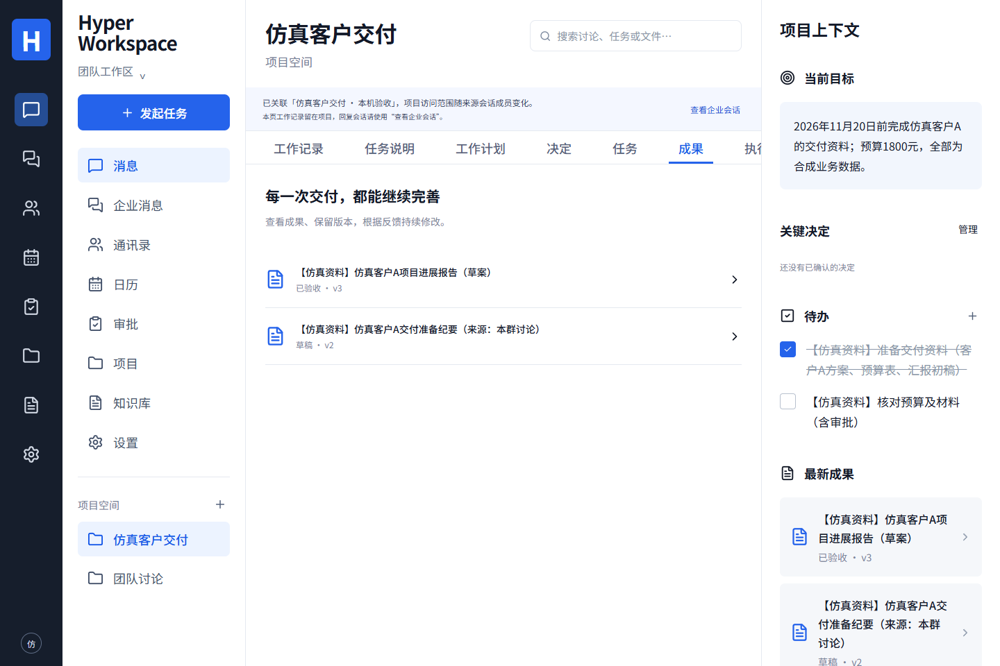

# Hyper Workspace

[简体中文](README.md) · [English](README.en.md)

[](https://github.com/MkaliezZ/hyper-workspace-next/actions/workflows/ci.yml)

Turn workplace discussions into editable outcomes with source references and execution receipts. Hyper Workspace brings enterprise messaging, projects, tasks, knowledge, calendars, approvals and Office collaboration into one workspace. Human actions, DSH and Hermes use the same product business services.

**Current stage: installable controlled-pilot release.** Local end-to-end checks use real services and real model calls with synthetic business data. Installation on the company's LAN Linux server, real-employee acceptance and production cutover remain pending; the target machine and fixed IP are not ready yet. The current product UI is in Chinese.



## Capabilities

| Area                              | Current behavior                                                                                                                                                                      |
| --------------------------------- | ------------------------------------------------------------------------------------------------------------------------------------------------------------------------------------- |
| Enterprise identity and messaging | Nextcloud login, direct/group conversations, history search, attachments, source-linked projects and membership checks                                                                |
| Projects and outcomes             | Discussion-to-minutes/tasks, explicit employee identity assignments, progress reports, manual editing, cross-engine revisions and version-bound acceptance                            |
| Knowledge and methods             | Permission-scoped document ingestion, keyword/vector retrieval, private answers with source-version and excerpt citations, versioned reusable methods                                 |
| Calendar scheduling               | CalDAV availability and candidates, recurrence/exceptions, invitations/replies, bounded series rescheduling and private project/task links                                            |
| Complex approvals                 | Versioned forms and flows, conditions, sequential/parallel stages, return/resubmit, transfer, reminders and audit; assigned employees confirm their own votes                         |
| Image and scan OCR                | PNG/JPEG/PDF pages, text/table correction, confirmed versions, private retrieval and access-revocation cleanup, backed by a real CPU recognizer                                       |
| Office and spreadsheets           | DOCX/XLSX/PPTX co-editing, comments, tracked revisions and conflict recovery; editable AI proposals and confirmed new copies; [compatibility limits](runtime/office/COMPATIBILITY.md) |
| Execution and configuration       | Independent worker, current permission/source-version checks, idempotency, cancellation/reconciliation, encrypted model credentials, usage and budget rules                           |

The product core owns enterprise assets, permissions, policies, versions and receipts. DSH is the default executor and Hermes is a required compatible executor. Switching executors preserves the shared business interface.

## Verification evidence

The November 12, 2026 local pilot used three synthetic source accounts, real Nextcloud/PostgreSQL/queues, both native executors, actual DeepSeek Flash calls, local BGE embeddings, CPU OCR and a pinned Collabora core. `DEMO_MODE=false`.

- Group conversation → minutes → identity-bound tasks → cross-engine revision → report v3 and simulated version acceptance.
- Calendar invitations/replies, conditional parallel and sequential approval, private OCR confirmation and indexing.
- Three Office formats: model draft → employee-edited proposal → confirmed copy → WebDAV/hash readback. A cross-sheet formula recalculated to 1800 while charts, tables, filtering and validation were retained.
- Real two-user Office editing, authored comments/replies, acceptance of tracked changes, active-session revocation and storage-conflict recovery.
- Desktop/mobile views, stale-source rejection, idempotency and persistence across API/worker/PostgreSQL restarts.

The [acceptance summary](docs/LOCAL-PILOT-ACCEPTANCE.md#english-summary) separates simulated employee UI actions, real models, protocol tests and company acceptance. The initial batch retains 18 successful and 15 failed runs, including unknown usage. Follow-up validation of the published startup module is recorded separately. Test counts are not a completion percentage.

[Mobile synthetic approval](docs/images/pilot-approval-mobile.png) · [Real CPU OCR review](docs/images/pilot-ocr-desktop.png) · [Implementation history (Chinese)](docs/IMPLEMENTATION.md)

## Download and installation

Get the source archive, `manifest.json` and `SHA256SUMS.txt` from [GitHub Releases](https://github.com/MkaliezZ/hyper-workspace-next/releases). Verify the exact revision, archive hashes and that revision's Actions results. The package includes source, migrations, dependency locks, tests and deployment documentation. Container images, runtime dependencies and model weights require separate preparation from pinned sources; a complete offline image bundle is not currently supplied.

The verified full runtime is Linux amd64. Windows development uses WSL2 Ubuntu. Prepare Docker Engine, Buildx, Compose and the documented Node/Python versions. To initialize private source-deployment configuration:

```bash
git clone https://github.com/MkaliezZ/hyper-workspace-next.git
cd hyper-workspace-next
node scripts/deploy-init.mjs
```

For a fixed delivery, switch to the release manifest's tag/revision before initialization. The generator creates independent secrets in a restricted `.env.compose` and refuses to overwrite existing configuration. Then configure source URLs, membership, administrator UIDs, model connections and the complete service combination.

Deployment guides below are in Chinese:

1. [Delivery entry](docs/DELIVERY.md): package contents, sequence and acceptance scope.
2. [Base deployment](docs/DEPLOYMENT.md) and [isolated source/BGE services](docs/DEPLOYMENT-PRIVATE-TRIAL.md): real source integration, restricted database roles, API and worker.
3. [OCR](docs/OCR.md), [online Office](docs/OFFICE.md) and [Office copy service](runtime/office/README.md): append the required Compose files while preserving the existing overlays.
4. [Company intranet deployment](docs/DEPLOYMENT-INTRANET.md): fixed internal IP, internal CA/IP SAN HTTPS and device trust. An external domain is not required.
5. [Product backup/restore](docs/BACKUP-RESTORE.md) and [source recovery](docs/SOURCE-BACKUP-RESTORE.md): retain configuration, encryption keys, volumes and rollback versions.

An [optional worker transport preflight](docs/WORKER-TRANSPORT-PREFLIGHT.md#english) addresses observed cold HTTPS connection failures. It sends no API key or prompt, generates no content, does not replace model transport, does not verify a model, and never replays a business action.

## Stack and development

React + TypeScript + Vite; NestJS; PostgreSQL + pgvector + pg-boss; an independent worker; Docker Compose. Nextcloud is integrated through providers. Online Office and background transformations use the same pinned Collabora core.

```bash
npm ci
npm run typecheck
npm test
npm run build
```

Prepare isolated environments for database, source, native-executor, Office and deployment checks using the [CI workflow](.github/workflows/ci.yml) and module documentation. Real-model checks require explicit execution and an authorized connection, and may incur provider charges.

## Delivery scope

- Installation and controlled pilot: source packages, deployment documentation, CI and actual workflow evidence are available.
- Company production: verify the target host/IP/certificates, employee identities and permissions, company-document quality, capacity, recovery/cutover and sign-off in the target environment.
- Format support follows explicit contracts and compatibility records. Audio/video and media editing remain later scope.
- Reported, partial and unknown usage, estimates and provider invoices remain distinct. Automated provider-invoice reconciliation is not implemented.

[PRD (Chinese)](docs/PRD.md) · [Phase-two baseline](docs/PHASE2-BASELINE.md) · [Formal acceptance gates](docs/DELIVERY-CHECKLIST.md#正式验收门槛) · [Windows handoff](docs/WINDOWS-HANDOFF.md) · [Historical README](docs/README-HISTORY.zh-CN.md)

## Contributing and license

See [contribution guidance](CONTRIBUTING.md#english) for reproducible issues, verification requirements and preservation of the frozen handoff package.

Project-owned code is licensed under [MIT](LICENSE). Third-party executors, Nextcloud/Collabora, system packages, model weights and frozen reference materials retain their applicable licenses, copyright and notices. The root license does not replace them. [Dependency/license records](docs/DEPENDENCIES.md) state their coverage; a complete third-party distribution review is a separate obligation.
