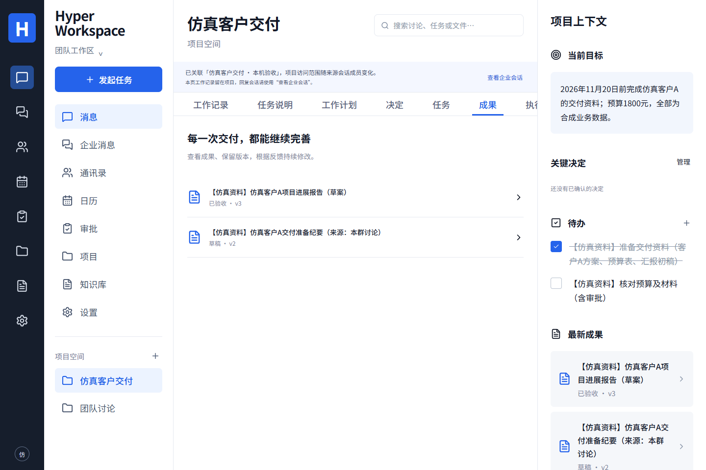

# Hyper Workspace

[简体中文](README.md) · [English](README.en.md)

[](https://github.com/MkaliezZ/hyper-workspace-next/actions/workflows/ci.yml)

把企业讨论推进为有依据、能修改、可核对的业务成果。Hyper Workspace 将企业消息、项目、任务、知识、日历、审批和 Office 协作放进同一个蓝白黑工作台；人工、DSH 与 Hermes 共用产品业务服务，动作以真实执行回执为准。

**当前阶段：可安装的受控试用交付版。** 已完成本机真实服务、真实模型与合成业务资料的端到端检查。公司局域网 Linux 服务器与固定 IP 仍待准备，正式安装、真实员工验收和生产切流分别记录。



## 能做什么

| 能力              | 当前结果                                                                                                                      |
| ----------------- | ----------------------------------------------------------------------------------------------------------------------------- |
| 企业消息与身份    | Nextcloud 企业登录、单聊/群聊、历史检索、附件、项目成员和权限关联                                                             |
| 项目与成果        | 讨论转纪要和待办、明确员工身份分配、进展报告、人工修改、跨执行器续改和版本验收                                                |
| 企业知识与方法    | 按当前权限导入文档、关键词/向量检索、带源版本和片段引用的私人问答、方法候选与版本复用                                         |
| 日历排期          | CalDAV 忙闲与候选时段、重复与例外、会议邀请/回复、受控整组改期、私人项目或待办关联                                            |
| 复杂审批          | 版本化表单和流程、条件分支、串行/并行会签、退回重提、转交、催办和审计；审批人确认自己的票                                     |
| 图片与扫描件 OCR  | PNG/JPEG/PDF 选页、文字/表格块校对、确认版本、私人检索与撤权清理；实际 CPU 引擎                                               |
| Office 与复杂表格 | DOCX/XLSX/PPTX 在线协作、评论与修订、冲突恢复；AI 可编辑方案和经确认的新副本；[具体兼容范围](runtime/office/COMPATIBILITY.md) |
| 执行与配置        | 独立 Worker、当前权限/源版本检查、幂等、取消/未知结果核对、模型密钥加密、用量与预算规则                                       |

企业资产、权限、Policy、版本和回执由产品核心保存。DSH 是默认执行器，Hermes 是必需的兼容执行器；切换执行器保持共用业务接口。

## 已验证到哪一步

2026-11-12 本机验收使用 3 个合成来源账号、真实 Nextcloud/PostgreSQL/队列、两套原生执行器、实际 DeepSeek Flash、本地 BGE 向量服务、CPU OCR 和固定 Collabora 内核。`DEMO_MODE=false`。

- 群聊 → 纪要 → 真实员工任务 → 跨引擎修订 → 报告 v3 与仿真版本验收。
- 日历邀请与接受回复、条件并行加串行审批、私人 OCR 确认和检索。
- 三格式 Office 起草、人工改方案、确认保存副本、下载与哈希回读；Excel 跨表公式重算为 1800，原图表、表格、筛选和数据验证保留。
- 真实双人 Office 编辑、评论往返、修订接受、活动会话撤权和保存冲突恢复。
- 桌面与手机页面、来源过期版本拒绝、幂等、数据库/API/Worker 重启后状态保留。

[完整验收摘要与失败记录](docs/LOCAL-PILOT-ACCEPTANCE.md)区分自动化模拟员工操作、真实模型、协议测试和公司验收。初次批次保留 18 个成功运行、15 个失败运行及未知用量；后续启动模块复验单独记录。自动化数量不换算为产品完成百分比。

[本机合成审批的手机界面](docs/images/pilot-approval-mobile.png) · [真实 CPU OCR 确认页](docs/images/pilot-ocr-desktop.png) · [实现与历史证据](docs/IMPLEMENTATION.md)

## 获取与安装

从 [GitHub Releases](https://github.com/MkaliezZ/hyper-workspace-next/releases) 获取交付源码包、`manifest.json` 和 `SHA256SUMS.txt`，核对固定 revision、归档摘要及该提交的 Actions。包内包含源码、迁移、依赖锁、测试和部署文档；Docker 镜像、运行依赖及模型权重需按固定来源另行准备，当前不提供离线全量镜像包。

支持的完整运行路径为 Linux amd64；Windows 开发端使用 WSL2 Ubuntu。准备 Docker Engine、Buildx、Compose 和部署文档指定的 Node/Python 版本。源码方式初始化配置：

```bash
git clone https://github.com/MkaliezZ/hyper-workspace-next.git
cd hyper-workspace-next
node scripts/deploy-init.mjs
```

安装固定交付版本时，先切换到 Release 清单对应的 tag/revision。配置生成器创建独立秘密和受限 `.env.compose`，拒绝覆盖已有文件；随后配置来源地址、成员组、管理员 UID、模型和服务组合。

1. [软件交付入口](docs/DELIVERY.md)：包内容、安装顺序与边界。
2. [基础部署](docs/DEPLOYMENT.md)与[独立来源/BGE](docs/DEPLOYMENT-PRIVATE-TRIAL.md)：真实来源、受限数据库角色、API 与 Worker。
3. [OCR](docs/OCR.md)、[在线 Office](docs/OFFICE.md)、[Office 副本服务](runtime/office/README.md)：追加所需 Compose 文件，保留已有叠加组合。
4. [公司内网安装](docs/DEPLOYMENT-INTRANET.md)：固定内网 IP、内部 CA/IP SAN HTTPS 和设备信任，无需购买外部域名。
5. [产品备份恢复](docs/BACKUP-RESTORE.md)与[来源配套恢复](docs/SOURCE-BACKUP-RESTORE.md)：保留原配置、主密钥、数据卷与回退版本。

慢网络出现进程首次 HTTPS 建连失败时，可按[可选 Worker 连接预检](docs/WORKER-TRANSPORT-PREFLIGHT.md)启用一次启动预检。它不携带 Key、不生成内容、不替换模型传输、不证明模型已验证，也不自动重放业务动作。

## 技术栈与开发

React + TypeScript + Vite；NestJS；PostgreSQL + pgvector + pg-boss；独立 Worker；Docker Compose。Nextcloud 通过 Provider 接入，Office 在线与后台变换使用同一固定 Collabora 内核。

```bash
npm ci
npm run typecheck
npm test
npm run build
```

数据库、真实来源、原生执行器、Office 与部署验证按 [CI 工作流](.github/workflows/ci.yml)及各模块文档准备隔离环境。真实模型验证需要显式执行与获准连接，可能产生供应商费用。

## 交付边界与后续

- 可安装与受控试用：已有源码包、部署文档、当前 CI 和实际业务证据。
- 公司正式上线：目标机/IP/证书信任、真实成员与权限、公司文档质量、容量、恢复切流及签收待目标环境核验。
- 格式支持按具体契约和兼容记录逐项确认；音视频和媒体编辑仍为后续范围。
- 用量中的 reported/partial/unknown、价格估算与供应商账单分开记录；自动供应商账单对账尚未实现。

[PRD](docs/PRD.md) · [扩展基线](docs/PHASE2-BASELINE.md) · [正式验收门槛](docs/DELIVERY-CHECKLIST.md#正式验收门槛) · [Windows 接手说明](docs/WINDOWS-HANDOFF.md) · [历史 README](docs/README-HISTORY.zh-CN.md)

## 贡献与许可

欢迎提交可复现问题和有明确验证范围的改进，见[贡献指南](CONTRIBUTING.md)。原冻结交接包保持字节可校验；源码、协议和文档同步维护。

本项目自有代码采用 [MIT](LICENSE)。第三方执行器、Nextcloud/Collabora、系统包、模型权重和冻结包材料保留各自适用的许可、版权与通知；根许可证不替代它们。[依赖与许可记录](docs/DEPENDENCIES.md)列明当前覆盖范围，全产品第三方许可核对不以根目录 MIT 作为完成证明。
