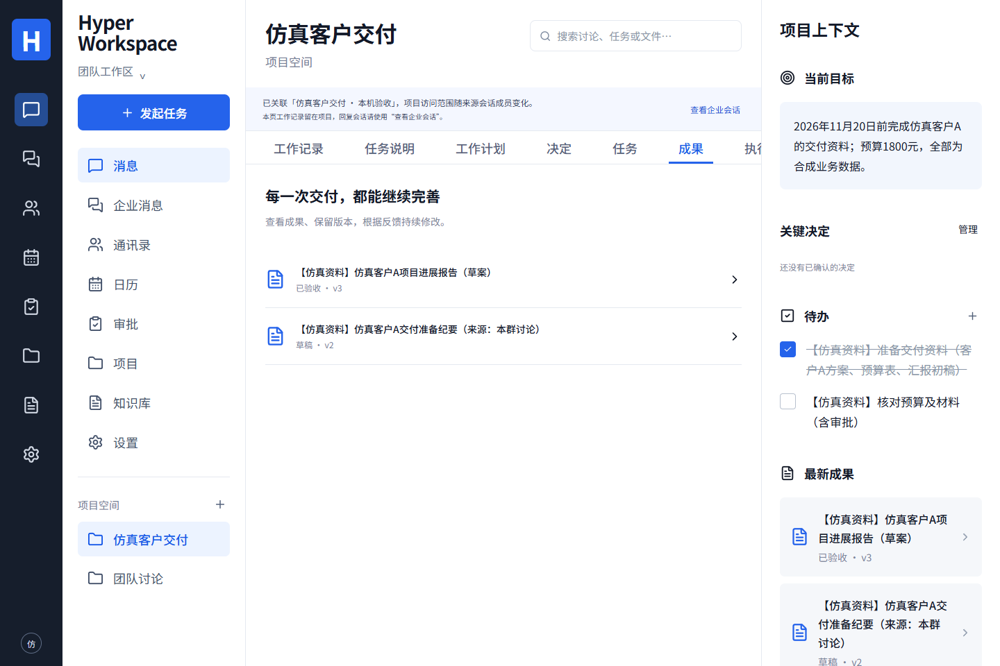

# 本机受控试用验收记录

[中文](#本机受控试用验收记录) · [English summary](#english-summary)

日期：2026-11-12。本页公开脱敏后的技术摘要。业务资料和账号全部为合成样例；实际 Key、会话、运行配置、数据库、完整私人日志和公司资料不在本仓库。

**结论：具备可安装、受控试用的软件交付条件。** 公司局域网 Linux 服务器与固定 IP 仍待准备；公司安装、真实员工质量评审、目标机容量与切流签收仍须在目标环境完成。此结论不改变冻结基线或 E01–E10 标准。

## 被核对的版本

- 端到端业务基线：`50c64f22fb65b7e8497061883ef0dcb1bcad167f`。
- [该基线的 Actions](https://github.com/MkaliezZ/hyper-workspace-next/actions/runs/43160228198)：verify、nextcloud-identity、office、deployment 四项全部通过。
- 本次交付另加入双语入口、文档核对和可选启动预检。新提交、归档摘要与完整 CI 由 Release 的 `manifest.json` 固定，不能将上述旧 SHA 的绿色结果代替新提交验证。
- 本机运行路径为 WSL2 Ubuntu / Linux amd64，9 个常驻服务健康，产品 `DEMO_MODE=false`，独立 API、Worker、PostgreSQL/pgvector/pg-boss、Nextcloud、CPU 向量/OCR、Office 在线与同核批处理服务均实际运行。

## 完整样例链路

| 环节           | 实际结果                                                                                                                              |
| -------------- | ------------------------------------------------------------------------------------------------------------------------------------- |
| 企业身份与消息 | 3 个合成账号通过真实来源登录授权；三人群聊、原消息回读、项目绑定及管理员/成员权限核对                                                 |
| 纪要与任务     | DSH 用实际 DeepSeek 生成纪要和两条待办；Hermes 修订为 v2；运营任务按明确员工身份分配并由该账号标记完成，另一条仍开放                  |
| 报告与版本     | Hermes 创建报告，DSH 按已回读业务更新；人工界面修改为 v3，创建者确认确切版本；普通成员验收他人成果被拒绝                              |
| 知识检索       | 私有文档导入、真实 BGE CPU 索引/检索、DSH 私人回答与源版本/片段引用；联系人姓名保持未知，回答明确片段覆盖范围                         |
| 日历排期       | DSH 实写 CalDAV 会议及邀请，运营经 Hermes 执行已确认的接受回复；来源状态、项目关联、忙闲候选和重复应用回读通过                        |
| 复杂审批       | 1800 元条件分支、两步并行会签及最终串行确认；浏览器模拟分派员工逐票确认；非分派人签票被拒绝                                           |
| OCR            | 真实 RapidOCR CPU 识别；人工修改并确认 v2、私人 BGE 索引；另一员工经 Hermes 取得自己的草稿；私人结果相互隔离                          |
| Office 三格式  | DOCX/XLSX/PPTX 真实模型起草、人工改方案、经另一执行器确认保存新副本、下载和 SHA256 回读；5 份原件完整哈希保持不变                     |
| 文件结构       | Word 标题和表格、PPT 页数和表格保留；Excel 跨表 SUM 重算为 1800，输入、图表、表格、筛选及数据验证保留                                 |
| 在线 Office    | 真实双人编辑、作者评论/回复、修订记录及接受；活动共享撤回后隔离；存储冲突保留外部版本并恢复为可打开副本                               |
| 防重复与源版本 | 旧 ETag 被拒绝；日历同一确认意图不重复建会；Office 同键请求找回原运行而不重复生成副本                                                 |
| 浏览器         | 真实资料下桌面、390px 手机、OCR 与审批页面通过；最终检查无页面异常或控制台错误                                                        |
| 重启           | 空闲时重启 API/Worker/PostgreSQL，登录会话、任务、成果版本与正文、审批、OCR、Office 和来源快照一致；重启后的首项 DSH 实际模型回读成功 |

“人工”表示浏览器自动化模拟合成账号的界面操作。它验证身份、确认、版本和实际记录，不冒充真实员工的质量判断。员工主动标记任务完成与独立验收分开，报告版本确认也不代表真实客户交付完成。

## 成功、失败与用量

初次完整批次保留 18 个成功 Run 和 15 个失败 Run，成功数包含诊断运行。产品账本保留 20 条未知传输结果，部分/未知/未定价状态没有改成零费用。一次报告修订提出了未授权成果目标，后端拒绝；明确固定目标后的修订成功，原拒绝保留。

另外 4 次独立模型连接/请求形状诊断未走产品账本，分别保留了供应商统计，合计 3572 tokens；它们没有产生业务成果。未配置供应商价格，不从这些 token 编造金额或账单。

本机还保留测试脚本修正记录，包括返回层级、评论作者显示名、过期网页登录态、保存后关闭对话框、文件夹导航等待及验收权限假设。最终各场景重新核对。未删除失败记录来得到全绿统计。

## 启动处理与安装边界

观察到首次 HTTPS 建连重置/超时后，采用[可选无凭据预检](WORKER-TRANSPORT-PREFLIGHT.md)。原模型网关保持不变，未保留临时响应代理或传输替换。原本机脚本的重启验证通过；提取为本仓库可复用模块后，Windows/Linux 5 项网络回归、实际 Compose 合并检查和一次新的首项 DSH 模型回读均通过。该发布模块复验单独记录，不并入前述 18/15 的历史批次。

首次构建曾遇到 Hermes 上游安装超时、OCR 依赖及模型下载超时。本机使用同锁的公开缓存；OCR 27 个固定依赖对照官方摘要，模型按仓库固定 SHA256 核对。未用 Mock 替代执行器、OCR 或模型，未关闭签名/证书/模型摘要检查。这个网络条件下的首次构建不代表在其他机器能立即离线安装。

发行物为带清单和校验和的源码包，依赖、镜像与权重需另行准备。公司主机/IP/CA 信任、实际成员/文档、并发与多员工冷加载、执行中故障/断电恢复及正式切流不在本次本机样例结论内。[安装入口](DELIVERY.md) · [Office 兼容范围](../runtime/office/COMPATIBILITY.md) · [完整正式门槛](DELIVERY-CHECKLIST.md#正式验收门槛)

[手机审批](images/pilot-approval-mobile.png) · [CPU OCR 确认](images/pilot-ocr-desktop.png)

## English summary

**Stage: installable controlled-pilot software.** The full business baseline is commit `50c64f22fb65b7e8497061883ef0dcb1bcad167f`, whose four CI jobs passed. The new release manifest pins the delivery commit, its own CI and archive hashes; baseline CI is not reused as proof of new changes.

The local Linux amd64 pilot ran nine real services with `DEMO_MODE=false`, three synthetic Nextcloud identities, both native executors, actual DeepSeek calls, BGE CPU embeddings, CPU OCR and a pinned Collabora core. The verified sample spans messaging/project binding, minutes/tasks, identity assignments, cross-engine revisions, report v3, permission-scoped retrieval and citations, calendar invitations/replies, conditional parallel/sequential approvals, private OCR and three editable Office copy formats.

Actual Office checks include simultaneous edits, authored comments/replies, accepted tracked revisions, active-session revocation and recovery to an editable copy after a storage conflict. Independent file inspection preserved the expected structures; a cross-sheet spreadsheet formula recalculated to 1800. All five synthetic originals retained their initial hashes. Desktop/mobile checks passed, and state survived an idle API/worker/PostgreSQL restart followed by a successful native model request.

The recorded baseline batch retains 18 successful and 15 failed runs, including diagnostic runs; 20 unknown-transport rows remain in the product ledger. A model-selected unauthorized revision target was rejected, then a new explicitly bound revision succeeded. Four separate model diagnostics outside the product ledger reported a total of 3572 tokens. No provider price or zero-cost assumption was invented.

“Human” steps were browser automation acting as synthetic employees. This validates UI confirmations and authorization, not actual employee quality judgment or customer sign-off. Task completion claims, version acceptance and real-world delivery remain distinct.

An optional startup transport preflight sends no key, prompt or generation. The original model gateway remains unchanged. The extracted release module passes five network regressions on Windows/Linux and an actual Compose restart plus first native DSH read; this follow-up is separate from the recorded 18/15 baseline batch. Installation timeouts and harness corrections remain documented above.

The company LAN server and fixed IP are still pending. Company installation/CA trust, real employees and documents, capacity, in-flight failure/disaster recovery and production cutover require target-environment acceptance. The release is a source distribution; pinned images, dependencies and model weights must be prepared separately.
